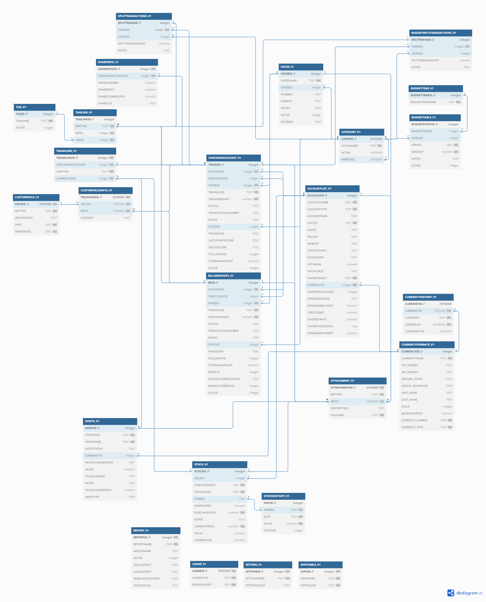

database
========

## Schema

Available in [tables.sql](tables.sql) file.

The [PocketBase schema](pocketbase/) shares the MMEX v21 table and field
baseline. It includes the collection import and default data used by the
WebApp; PocketBase IDs, rules, indexes and storage semantics are distinct
from SQLite. See [PocketBase maintenance](pocketbase/README.md).

## UML (as of v19)

**Click the image below for an interactive diagram**

Relations not implemented at SQL level:

* CUSTOMFIELDDATA.REFID (depends on CUSTOMFIELD.REFTYPE)
* ATTACHMENT.REFID (depends on ATTACHMENT.REFTYPE)
* TRANSLINK.LINKRECORDID (depends on TRANSLINK.LINKTYPE)
* TAGLINK.REFID (depends on TAGLINK.REFTYPE)

## Initialization

Initial category / subcategory hierarchy:

* Bills
  * Telephone
  * Electricity
  * Gas
  * Internet
  * Rent
  * Cable TV
  * Water
* Food
  * Groceries
  * Dining out
* Leisure
  * Movies
  * Video Rental
  * Magazines
* Automobile
  * Maintenance
  * Gas
  * Parking
  * Registration
* Education
  * Books
  * Tuition
  * Others
* Homeneeds
  * Clothing
  * Furnishing
  * Others
* Healthcare
  * Health
  * Dental
  * Eyecare
  * Physician
  * Prescriptions
* Insurance
  * Life
  * Home
  * Health
  * Auto
* Vacation
  * Travel
  * Lodging
  * Sightseeing
* Taxes
  * Income Tax
  * House Tax
  * Water Tax
  * Others
* Miscellaneous
* Gifts
* Income
  * Salary
  * Reimbursement/Refunds
  * Investment Income
* Other Income
* Other Expenses
* Transfer
